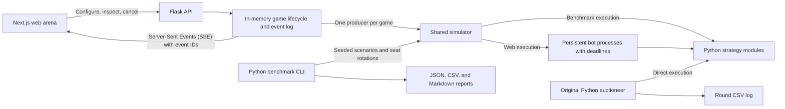

# BiddingSimulation — Research on Sequential Multi-Agent Auctions

BiddingSimulation investigates adaptive bidding, budget-constrained resource allocation, and opponent-aware decision-making in sequential multi-agent first-price auctions with collection-dependent rewards. The project provides 13 registered strategies, a shared simulator, a seeded comparative evaluation framework, and an interactive web arena for inspecting bidding, spending, and scoring round by round.

## Research motivation

Each bid commits part of a finite budget if it wins. A policy must weigh the immediate value of a painting against the cost of acquiring it and the opportunities that remain. The multiplicative score makes a collection with a missing category worth zero, even if it contains many paintings. Once all categories are represented, another painting can be especially valuable in an underrepresented category. Opponent budgets, collections, and observed winning prices influence how much it costs to build that collection.

Three outcomes matter for different reasons. Absolute score measures the value of the final collection, game win rate measures performance relative to a specific opponent roster, and score per credit measures spending efficiency.

## Research questions

The simulator and comparison framework support investigation of six questions.

| ID | Question |
| --- | --- |
| RQ1 | How should limited resources be allocated across sequential auctions? |
| RQ2 | How valuable is adaptation to observed competitor behavior and market prices? |
| RQ3 | How do multiplicative collection rewards change optimal bidding priorities? |
| RQ4 | How do Q-learning-based and heuristic policies compare? |
| RQ5 | How sensitive are policies to auction duration, room composition, and budgets? |
| RQ6 | Why might win rate, absolute score, and spending efficiency favor different policies? |

The observations below are specific to the evaluated scenarios. The framework supports further comparisons to address these questions.

## Key contributions

- **Bidding policies.** The strategy library includes fixed and random baselines, heuristics for collection balance and budget pacing, opponent and price models, and inference with a frozen tabular Q-policy.
- **Shared simulation engine.** The benchmark and web arena use common bid handling, auction rules, scoring, and accounting. A reference mode preserves historical auction behavior, and a custom mode supports configurable budgets and horizons.
- **Reproducible evaluation.** The benchmark uses matched painting sequences, seeded runs, seat rotations, and seed-level bootstrap intervals. It exports both trial records and scenario summaries.
- **Interactive inspection and verification.** The web arena streams and replays bids, budgets, scores, and results. Automated checks cover rule parity, deterministic comparisons, and the browser workflow.

## Auction model and scoring

A room has at least two strategy instances. Each round offers one painting from four categories: Da Vinci, Picasso, Rembrandt, and Van Gogh. The simulator draws categories with replacement unless supplied an explicit sequence. At bid time, agents receive the full `painting_order`, including future lots, along with player budgets, collections, scores, and the winner and payment histories of completed rounds.

Bid returns are converted through Python's `int()`. Failed conversions, bid exceptions, and bids above the current budget become zero. After validation, the highest bid wins the painting. Only the winner pays, and its own bid is deducted from its remaining budget. Ties are broken randomly, including when every bid is zero.

For bidder $i$, let $n_{i,a}$ denote the number of paintings in its collection by artist $a$. The score is

$$
S_i = \prod_{a \in \mathcal{A}} n_{i,a},
\qquad
\mathcal{A} = \{\text{Da Vinci},\ \text{Picasso},\ \text{Rembrandt},\ \text{Van Gogh}\}.
$$

The auction ends at the configured round limit. The highest positive final score wins, a tie for that score yields shared winners, and an all-zero leaderboard yields no winner. The score is a per-game collection value. The benchmark win rate is the fraction of games in which the focus strategy is a sole or shared winner. The `target_collection` parameter is a hint available to strategies. The score and stopping rule are determined by the product above and the round limit, respectively.

| Rule | Reference mode | Custom mode |
| --- | --- | --- |
| Horizon and starting credits | 200 rounds and 1,001 credits per seat | Configurable rounds and starting credits |
| Bidder order | Subsequent rounds use the previous round's descending bid order, with randomized ties | Fixed seat order |
| Negative bids | Affordable negative bids are accepted. A winning negative bid increases the winner's budget. | Negative bids become zero. |

The simulator selects reference mode by default at 200 rounds with 1,001 credits for every seat. Other settings select custom mode automatically. Custom mode can also be selected explicitly at the reference settings. Web execution also zeroes bids that would raise a balance above JavaScript's safe integer limit.

## Bidding strategies

| Strategy | Python module | Decision mechanism |
| --- | --- | --- |
| Fixed Bid 10 | [`bots.fixed_bid_10`](bots/fixed_bid_10.py) | Returns 10 each round. |
| Fixed Bid 15 | [`bots.fixed_bid_15`](bots/fixed_bid_15.py) | Returns a constant bid of 15 by default. |
| Fixed Bid 20 | [`bots.fixed_bid_20`](bots/fixed_bid_20.py) | Returns a constant bid of 20 by default. |
| Random Budget Bidder | [`bots.random_budget_bidder`](bots/random_budget_bidder.py) | Samples uniformly from integers between zero and the remaining budget, inclusive. |
| Collection Balancer | [`bots.collection_balancer`](bots/collection_balancer.py) | Combines budget pace and smoothed log-score gain with collection imbalance, remaining supply, and opponent price pressure. |
| Price Profile Bidder | [`bots.price_profile_bidder`](bots/price_profile_bidder.py) | Uses winning-price distributions and percentile anchors, with lower anchors when early observations are sparse or the price profile is volatile. |
| Room-Size Bidder | [`bots.room_size_bidder`](bots/room_size_bidder.py) | Uses separate rules for rooms of up to five and larger rooms, with different price floors and opponent-pressure adjustments. |
| Adaptive Market Bidder | [`bots.adaptive_market_bidder`](bots/adaptive_market_bidder.py) | Estimates prices from recent payments, models opponent demand, and adjusts bids by artist based on its own wins and losses. |
| Fixed-Bid Specialist | [`bots.fixed_bid_specialist`](bots/fixed_bid_specialist.py) | Detects winning-price patterns near 10 and 15 credits and can set bid floors just above them for needed artists. |
| Weighted Strategy Blend | [`bots.weighted_strategy_blend`](bots/weighted_strategy_blend.py) | Blends collection, budget, supply, opponent, market, and room signals with the specialist's pricing rules and uses advisor bids at selected horizons. |
| Budget Reserve Bidder | [`bots.budget_reserve_bidder`](bots/budget_reserve_bidder.py) | Paces spending using reserve and bid caps based on rounds remaining, with more spending flexibility in the endgame. |
| Endgame Boost Bidder | [`bots.endgame_boost_bidder`](bots/endgame_boost_bidder.py) | Adds small premiums for opponent pressure on needed artists and for late bottleneck or scarce paintings. |
| Q-Learning Bidder | [`bots.q_learning_bidder`](bots/q_learning_bidder.py) | In rooms of five or more, looks up an action in a frozen Q-table and uses a heuristic action for unseen states. Rooms of two to four use a separate heuristic bid. |

## Research methodology

Each scenario specifies a focus strategy, opponent roster, round limit, starting budget, and rule mode. The default suite places each focus strategy in a two-player room against Random Budget Bidder and a five-player mixed room against Random Budget Bidder and Fixed Bid 10, 15, and 20. Explicit rooms support other matchups, including multiple seats using the same strategy.

At each seed and round count, rooms receive the same painting sequence. Each scenario runs once per cyclic seat rotation for every seed by default, so the focus strategy occupies every seat. The benchmark carries the random baseline's seed with its logical player across rotations and uses a separate simulator random stream for tie breaks.

The benchmark records sole wins, shared wins, losses, and no-winner games. All games enter the win-rate denominator. It also reports mean and median final score, mean competition rank, mean remaining budget, and score per credit. Score per credit divides the sum of final scores by total net credits spent across games, using starting budget minus final budget for each game. The ratio is omitted when total net spending is nonpositive.

The 95% win-rate interval uses 1,000 bootstrap draws over seed-level win rates when at least two distinct seeds are available. Rotations within a seed share a painting sequence and stay together. Independent seeds are the resampling units.

## Key research observations

Each focus strategy faced the same four opponent slots in the five-player mixed room, with 1,001 starting credits per seat. Each row represents a separate focus-strategy series and uses the reported precision. [Engineering report results](ENGINEERING_REPORT.md#e-performance-and-benchmarking)

| Five-player mixed-room scenario | Focus strategy | Game wins | Mean score | Score per credit |
| --- | --- | ---: | ---: | ---: |
| **50 rounds · Custom mode** | Fixed-Bid Specialist | 25/25 | 1,320 | 1.33 |
| **50 rounds · Custom mode** | Price Profile Bidder | 20/25 | 2,776 | 3.25 |
| **200 rounds · Reference mode** | Fixed Bid 15 | 11/25 | 67,874 | 68.56 |
| **200 rounds · Reference mode** | Q-Learning Bidder | 0/25 | 42,070 | 44.23 |

In the 50-round custom scenario, Fixed-Bid Specialist won more games, while Price Profile Bidder achieved a higher mean score and more score per credit against the same opponent roster. Both the horizon and rule mode change between the reported scenarios, so their results cannot isolate the effect of auction duration.

Each series used **five independent seeds**, with five seat rotations per seed. This limits the precision of the win-rate intervals. A constant set of seed-level win rates yields a zero-width interval in this bootstrap.

## System architecture



The arena supports live standings and charts, round playback, and reconnecting to retained games. Exports include a round CSV, a game JSON with configuration and event history, and a final summary JSON. Backend games and their event logs are retained in memory for a bounded time.

## Getting started

Use Python 3.10 or newer. For the web frontend, use Node.js 22, the version configured in CI. Python checks have run locally on 3.10.19, and CI targets Python 3.12. From the repository root, create an environment and install the Python dependencies for the backend and local checks.

```bash
python -m venv .venv
source .venv/bin/activate
python -m pip install -r web-app/backend/requirements-dev.txt
```

On Windows PowerShell, activate with `.\.venv\Scripts\Activate.ps1`.

For the original Python auction, run `python auctioneer.py` from the root. Its sample room runs 200 rounds and appends semicolon-delimited rows to `data/auctioneer_log.csv`.

For the web arena, start Flask from the root with the virtual environment active.

```bash
cd web-app
python -m flask --app backend.app:create_app run --host 127.0.0.1 --port 5000
```

In a second terminal, start Next.js from the repository root.

```bash
cd web-app/frontend
npm ci
npm run dev
```

Open the [web arena](http://localhost:3000). The [strategy API](http://127.0.0.1:5000/api/bots) lists the available strategies and setup limits. See the [web arena guide](WEB_APP.md) for configuration, API details, and troubleshooting.

## Running research comparisons

Run these examples from the repository root with the Python environment active.

```bash
# Reproduce the default suite with five independent seeds and both rule modes.
python benchmark.py --trials 5 --output data/benchmark-validation

# Compare two focus strategies at both horizons under the same rule mode.
python benchmark.py --focus fixed_bid_specialist price_profile_bidder --rounds 50 200 --mode custom --seeds 0 1 2 3 4 --output data/benchmark-custom

# Set the opponent roster explicitly with the focus strategy first.
python benchmark.py --room adaptive_market_bidder random_budget_bidder random_budget_bidder --rounds 50 --mode custom --budget 750 --seeds 7 21 58 --output data/benchmark-room
```

`--trials 5` uses seeds 0 through 4. `--seeds` supplies distinct seed values explicitly. `--focus` selects strategies for the built-in opponent rosters, while `--room` specifies one roster with its focus strategy first. `--budget` sets common starting credits per seat. Use `--mode custom` at each horizon when studying duration with the rule mode held fixed. `--fixed-seats` runs only the listed order.

Each run writes three files to `--output`, which defaults to `data/benchmark/`. Outputs under `data/` are ignored by Git.

| File | Contents |
| --- | --- |
| `results.json` | Versioned scenario settings, aggregate summaries, and per-game records with seed, rotation, seat order, effective mode, outcome, score, rank, spending, and bid errors. |
| `summary.csv` | One row per scenario for analysis, including settings, outcome counts, scores, budget metrics, and the win-rate interval when available. |
| `summary.md` | A readable comparison table with effective rule modes, outcome counts, intervals, and aggregate metrics. |

## Extending a strategy

Create a module under `bots/` with a `Bot` constructor callable without arguments and a string `name`. The simulator supplies these arguments by keyword.

```python
def get_bid(
    self, current_round, bots, winner_pays, artists_and_values, round_limit,
    starting_budget, painting_order, target_collection, my_bot_details,
    current_painting, winner_ids, amounts_paid,
):
    return 0
```

- Read the seat's budget, collection, and score from `my_bot_details`. Use `bot_unique_id` to identify the seat in `bots` and `winner_ids`. Names can recur, and reference-mode bidder order can change after every round. Bot round indices start at zero, and round results start at one.
- Reference mode includes a copied `bot_instance` and a zeroed `current_bid` in `my_bot_details`. Custom mode adds `player_name` to the seat dictionaries. Use the fields common to both modes for portable strategies.
- Store learned state on the live instance (`self`). Treat input dictionaries as snapshots. Return an affordable, nonnegative integer for compatibility across rule modes. Check duplicate instances, short auctions, per-seat budgets, and exhausted budgets.
- For stochastic policies, keep state on a seedable per-instance random generator. The web worker seeds Python's `random` before constructing each bot. The direct simulator injects a benchmark RNG into Random Budget Bidder specifically. An additional stochastic policy needs explicit seed wiring for repeatable benchmark runs.
- Add the module path and display name to `BOT_NAMES` to expose it in the arena and benchmark. Keep the registry name consistent with `Bot.name`. [Strategy registry](web-app/backend/bot_registry.py)
- Run trusted strategy code. The arena's worker processes enforce bid deadlines and inherit the application's operating-system permissions. The benchmark runs strategy code directly in its own process.

## Verification and reproducibility

From the repository root, run `python -m pytest -q`, `ruff check`, and `ruff format --check`. From `web-app/frontend`, use `npm run check`, `npm run lint`, and `npm run build`. After `npx playwright install chromium`, use `npm test` with the Python environment active. Playwright starts its own Flask and Next.js servers.

The Python suite compares reference mode with the original auctioneer under controlled bids and matched randomness. It verifies strategy inputs, painting order, tie outcomes, payments, budgets, collections, scores, and winner order. It also covers custom rules, reproducibility, duplicate strategy seats, and event lifecycle behavior. The browser suite exercises live auctions, replay, reconnect, cancellation, exports, and error handling. [Python tests](web-app/backend/tests/), [Browser tests](web-app/frontend/tests/arena.spec.ts)

The GitHub Actions workflow defines Python and frontend checks for pushes and pull requests. Its deterministic benchmark check runs the same seeded room twice and compares the JSON, CSV, and Markdown outputs byte for byte. The engineering report's counts of 85 Python tests and five browser tests are historical local results. [CI workflow](.github/workflows/ci.yml), [Engineering verification record](ENGINEERING_REPORT.md#c-verification)

## Limitations and further research

- **Statistical power.** The reported matrix used five independent seeds and two baseline rosters. Larger seed sets and more varied opponents would improve precision and test whether the observations hold across matchups.
- **Q-learning reproducibility.** Inference uses a frozen table and heuristic fallbacks. Reproducing training requires the original trainer and training data, which are absent from the repository.
- **Information available to agents.** Agents receive the full painting sequence. An incomplete-information extension could restrict future supply visibility and measure how policies respond to that uncertainty.
- **Policy components.** Isolating price estimation, opponent modeling, and budget reserves would clarify their individual effects. Duration comparisons should hold the rule mode, roster, and starting budget fixed and account for absolute round thresholds in some heuristics.
- **Local persistence.** The single-process web backend stores games in memory. Games expire and a restart clears the store. Exported results provide a record for later analysis.

## Repository structure

| Path | Role |
| --- | --- |
| [`auctioneer.py`](auctioneer.py) | Original Python auction and reference behavior |
| [`benchmark.py`](benchmark.py) | Scenario runner, aggregation, and research reports |
| [`bots/`](bots/) | Strategy implementations and original module aliases |
| [`web-app/backend/`](web-app/backend/) | Flask API, simulator, strategy registry, bid workers, and Python tests |
| [`web-app/frontend/`](web-app/frontend/) | Next.js arena and Playwright tests |
| [`WEB_APP.md`](WEB_APP.md) | Web setup, API reference, configuration, and troubleshooting |
| [`ENGINEERING_REPORT.md`](ENGINEERING_REPORT.md) | Engineering validation and reported research comparisons |
