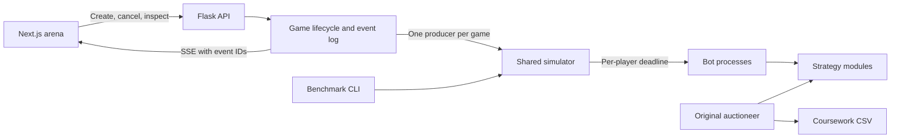

# BiddingSimulation

Run painting auctions with Python strategies, follow them in a local web arena, and compare strategies across repeatable experiments. The repository includes 13 strategies and the original coursework auctioneer in `auctioneer.py`.

## Quick start

Use Python 3.10 or newer and Node.js 22 LTS for the web app. All commands in this section start at the repository root.

```bash
python -m venv .venv
source .venv/bin/activate
python -m pip install -r web-app/backend/requirements-dev.txt
```

On Windows PowerShell, activate with `.\.venv\Scripts\Activate.ps1`.

- Run the original auction with `python auctioneer.py`. The example room runs 200 rounds with a short delay and appends a semicolon-delimited log to `data/auctioneer_log.csv`.
- Run the Python tests with `python -m pytest -q`.
- Run the web arena with the two-terminal setup in [WEB_APP.md](WEB_APP.md).
- Run a seeded strategy comparison with `python benchmark.py --trials 5`.

## Auction rules

A room contains at least two bot instances. Each round auctions one painting drawn with replacement from Da Vinci, Picasso, Rembrandt, and Van Gogh. Every bot bids against its remaining budget. The highest bidder pays its own bid and receives the painting. Ties, including a round of all-zero bids, are broken randomly. A player's score is the product of its four artist counts. The highest positive score wins, matching positive scores share the win, and an all-zero scoreboard has no winner. The auction finishes at its round limit. `target_collection` is a strategy input.

| Behavior | Coursework reference mode | Custom simulation mode |
| --- | --- | --- |
| Rounds and credits | 200 rounds, 1,001 credits per player | Configurable rounds and starting budget per player |
| Bot order | Previous round's descending bid order with random tie breaks | Seat order throughout |
| Negative bids | Accepted if affordable, increasing the winner's budget if paid | Converted to zero |
| Inputs | Coursework player dictionaries, including the bot's own copied instance and reset bid | Adds player names and supplies each bot's configured starting budget |
| Seeded paintings | Draws using the coursework artist order | Uses the arena's existing artist order by default |

Both modes use Python's `int()` conversion, so `7.9` becomes `7` and the string `"7.9"` produces a bidding error. Invalid or over-budget bids become zero. The web server also enforces bot timeouts and JavaScript's safe integer range for credit amounts. Reference mode isolates strategy randomness from the auction draw and tie-break sequence. Seeded results are reproducible in BiddingSimulation, and a randomized coursework run can have a different draw sequence.

The original entry point accepts the same bots and options as before:

```python
from auctioneer import Auctioneer
from bots import fixed_bid_10, random_budget_bidder

winners = Auctioneer(room=[fixed_bid_10, random_budget_bidder], slowdown=0).run_auction()
```

## Architecture



The browser can reconnect using the game's URL, inspect stored rounds, play them back, and export round CSV, game JSON, and final summary JSON. The backend retains results in memory for a limited time. Download a copy for longer-term comparison.

## Strategies

| Strategy | Python module | Approach |
| --- | --- | --- |
| Collection Balancer | `bots.collection_balancer` | Prioritizes artists with fewer paintings and adjusts to scarcity. |
| Room-Size Bidder | `bots.room_size_bidder` | Uses different pricing and spending rules in small and large rooms. |
| Adaptive Market Bidder | `bots.adaptive_market_bidder` | Learns from prices and its own recent wins and losses. |
| Fixed-Bid Specialist | `bots.fixed_bid_specialist` | Detects recurring fixed prices and bids above them when it needs the artist. |
| Weighted Strategy Blend | `bots.weighted_strategy_blend` | Blends collection, supply, market, and room signals. |
| Budget Reserve Bidder | `bots.budget_reserve_bidder` | Reserves funds early and relaxes spending caps as the auction progresses. |
| Endgame Boost Bidder | `bots.endgame_boost_bidder` | Raises some bids for opponent pressure and missing paintings late in a game. |
| Q-Learning Bidder | `bots.q_learning_bidder` | Uses a frozen offline-trained Q-table with heuristic fallbacks. |
| Price Profile Bidder | `bots.price_profile_bidder` | Uses price history and lower price anchors when observations are sparse or volatile. |
| Random Budget Bidder | `bots.random_budget_bidder` | Draws an integer from zero to its remaining budget. |
| Fixed Bid 10 | `bots.fixed_bid_10` | Bids 10 each round. |
| Fixed Bid 15 | `bots.fixed_bid_15` | Bids 15 each round by default. |
| Fixed Bid 20 | `bots.fixed_bid_20` | Bids 20 each round by default. |

The change to Adaptive Market Bidder keys self and history lookups by seat ID. It also fixes calls through the short-auction advisor in Weighted Strategy Blend. Other strategies keep their bidding policies, including absolute phase thresholds in some heuristics. The Q-Learning Bidder uses a heuristic in rooms of two through four and falls back to a heuristic action for unseen states in larger rooms. The repository contains the frozen values and inference code. The training data, reward history, and trainer needed to recreate them are unavailable.

## Writing a strategy

Define a zero-argument `Bot` constructor with a string `name`. Keep the `get_bid(current_round, bots, winner_pays, artists_and_values, round_limit, starting_budget, painting_order, target_collection, my_bot_details, current_painting, winner_ids, amounts_paid)` keyword interface. Rounds are zero-indexed in bot input and one-indexed in results.

- Read your own `budget`, `paintings`, and `score` from `my_bot_details`. Use `bot_unique_id` for self and history lookups. Several seats can have the same bot name.
- Keep learned state on the instance. The web worker seeds Python's `random` for each bot. For strategies used in the direct Python benchmark, give each instance its own seedable RNG, following `random_budget_bidder.py`.
- Return an affordable integer. Test short rooms, exhausted budgets, repeated instances, and changing seat order. Avoid assuming that 200 rounds or a common starting budget applies in custom games.
- Register repository-owned strategies in `web-app/backend/bot_registry.py` to expose them to the web arena. Run code you trust locally. Worker processes enforce deadlines and run with the application's operating-system permissions.

## Benchmarking

```bash
# All strategies, two and five players, 50 and 200 rounds
python benchmark.py --trials 5

# Reproduce a specific room and allow the same strategy in multiple seats
python benchmark.py --room adaptive_market_bidder random_budget_bidder random_budget_bidder --rounds 50 200 --seeds 7 21 58

# Seeded comparison at a custom starting budget
python benchmark.py --focus q_learning_bidder price_profile_bidder --rounds 75 --budget 750 --trials 10
```

The first module in an explicit room is the focus strategy. The default suite evaluates each focus strategy against one random opponent and against a roster of one random and three fixed-price opponents. Each seed uses a matched painting sequence. The focus and opponents rotate through every seat, with opponent RNG seeds assigned to logical slots. `--fixed-seats` keeps the listed order. The four older validation scripts remain runnable using their historical room matrices and now write the standard reports.

`data/benchmark/` holds detailed `results.json`, `summary.csv`, and a readable `summary.md`. Results include sole and shared wins, losses, no-winner games, mean and median score, remaining budget, score per aggregate credit spent, and competition rank. Confidence intervals use a 95% bootstrap that resamples whole seeds and keeps rotations together. Short runs and constant samples give limited or degenerate intervals. Compare results within the same room, starting budget, and round count. To study auction length while keeping rule behavior fixed, pass `--mode custom` at every length.

## Development checks

```bash
python -m compileall -q auctioneer.py arena.py benchmark.py utilities.py bots web-app/backend
ruff check
ruff format --check
python -m pytest -q
```

Run the frontend checks and browser tests using [WEB_APP.md](WEB_APP.md). CI runs both suites and a small deterministic benchmark on pushes and pull requests. Keep the coursework reference file byte-for-byte unchanged and avoid bulk formatting changes to experimental strategies.
